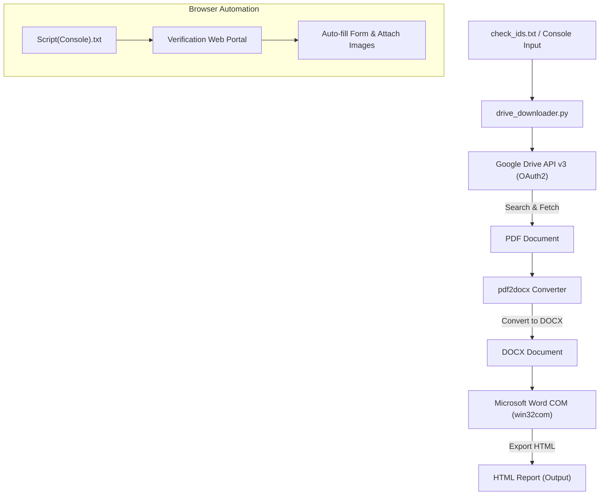

# 📁 Drive Batch Downloader & Document Automation Pipeline

[](https://www.python.org/)
[](https://developers.google.com/drive)
[](https://www.microsoft.com/)
[](LICENSE)

An end-to-end automated toolchain designed to batch-search Google Drive files by reference IDs, download documents, convert PDFs to editable Word DOCX, render them into HTML via Microsoft Word Automation, and automate web verification form entries with companion browser scripts.

---

## 📑 Table of Contents

- [Overview](#-overview)
- [System Architecture](#-system-architecture)
- [Key Features](#-key-features)
- [Project Structure](#-project-structure)
- [Prerequisites](#-prerequisites)
- [Installation & Setup](#-installation--setup)
  - [1. Clone Repository](#1-clone-repository)
  - [2. Install Dependencies](#2-install-dependencies)
  - [3. Configure Google Drive API](#3-configure-google-drive-api)
- [Usage Guide](#-usage-guide)
  - [1. Batch Drive Downloader & Converter](#1-batch-drive-downloader--converter)
  - [2. Browser Console Automation Tool](#2-browser-console-automation-tool)
- [Error Handling & Recovery](#-error-handling--recovery)
- [Security Notice](#-security-notice)
- [License](#-license)

---

## 🔍 Overview

When managing large volumes of case verifications and field inspection documents, downloading files one by one and converting them manually is tedious and error-prone. 

This repository provides:
1. **Python Pipeline (`drive_downloader.py`)**: Takes a list of reference IDs, automatically finds and downloads matching files from Google Drive (personal or Shared Drives), converts PDFs to DOCX, and renders them to HTML using Word COM Automation.
2. **Browser Console Script (`Script(Console).txt`)**: Automates browser-based field verification forms by selecting standard status options, injecting customized comments, and managing photo uploads.

---

## 🏗 System Architecture



---

## ✨ Key Features

- **⚡ Batch ID Querying**: Feed hundreds of IDs at once via `check_ids.txt` or interactive CLI paste (supports commas, spaces, or newlines).
- **☁️ Multi-Drive Support**: Supports personal drives and Google Workspace Shared Drives (`supportsAllDrives=True`).
- **🔁 Intelligent Resumption & Deduplication**: Skips IDs that have already been converted to HTML, saving bandwidth and execution time.
- **🛡️ Auto-Recovery for MS Word COM**: Recovers and restarts background Microsoft Word instances if the COM server hangs during conversion.
- **📋 Failure Logging**: Unfound or failed IDs are captured in `failed.txt` for easy tracking and re-runs.
- **🌐 Browser Portal Automation**: Injects verification remarks, toggles radio buttons and dropdowns, and handles file attachments under 500 KB.

---

## 📂 Project Structure

```plaintext
drive-downloader/
├── drive_downloader.py          # Main Python automation & conversion script
├── Script(Console).txt          # Browser console automation script for form verification
├── check_ids.txt                # Input reference IDs list (one per line or delimited)
├── check_ids.example.txt        # Sample template for reference IDs
├── requirements.txt             # Python package dependencies
├── credentials.json.example     # Template for Google OAuth 2.0 Client credentials
├── .gitignore                   # Excludes secret credentials, temp files, and outputs
└── README.md                    # Project documentation
```

### Runtime Directories (Auto-Generated)
- `downloads/` — Stores original downloaded PDF files from Google Drive.
- `docx/` — Stores intermediate Word documents generated by `pdf2docx`.
- `html/` — Stores final exported `.htm` documents generated by Word.
- `failed.txt` — Generated when one or more IDs fail or cannot be found on Drive.

---

## ⚙️ Prerequisites

1. **Operating System**: Windows 10 / 11 (required for Microsoft Word COM automation).
2. **Python**: Python 3.8 or higher.
3. **Microsoft Office / Word**: Desktop version of Microsoft Word installed.
4. **Google Cloud Account**: A project with **Google Drive API** enabled.

---

## 🚀 Installation & Setup

### 1. Clone Repository

```bash
git clone https://github.com/Ashesh88/drive-downloader.git
cd drive-downloader
```

### 2. Install Dependencies

Create a virtual environment (recommended) and install required dependencies:

```bash
python -m venv venv
venv\Scripts\activate
pip install -r requirements.txt
```

### 3. Configure Google Drive API

1. Visit the [Google Cloud Console](https://console.cloud.google.com/).
2. Create a new project or select an existing one.
3. Enable the **Google Drive API** under **APIs & Services > Library**.
4. Go to **APIs & Services > Credentials**:
   - Click **Create Credentials** > **OAuth client ID**.
   - Select Application type: **Desktop App**.
   - Download the generated JSON credentials.
5. Rename the downloaded file to `credentials.json` and place it in the root of this project folder (next to `drive_downloader.py`).

> [!NOTE]
> On the first run, a browser tab will automatically open asking you to log into your Google Account and grant read-only access to Drive. The session will be saved locally as `token.json` for subsequent silent logins.

---

## 💻 Usage Guide

### 1. Batch Drive Downloader & Converter

1. Add your reference IDs to [`check_ids.txt`](check_ids.txt) (one per line, space-separated, or comma-separated):
   ```text
   169054659
   165575359
   151191894
   ```
2. Execute the script:
   ```bash
   python drive_downloader.py
   ```
3. The script will:
   - Authenticate with Google Drive.
   - Search each ID across all drives.
   - Download matching files into `downloads/`.
   - Convert PDF to DOCX in `docx/`.
   - Render DOCX into HTML in `html/`.
   - Output summary statistics and log any failed IDs to `failed.txt`.

---

### 2. Browser Console Automation Tool

The file [`Script(Console).txt`](Script(Console).txt) contains an automated script for field verification web portals:

1. Open your verification portal in Google Chrome / Edge.
2. Open Developer Tools (`F12` or `Ctrl + Shift + I`) and switch to the **Console** tab.
3. Copy the contents of [`Script(Console).txt`](Script(Console).txt) and paste it into the console.
4. Press `Enter` to run. The script will:
   - Select default radio values (e.g., Address Visited, Traceable, Case Closed).
   - Configure select dropdowns (e.g., Status: Picked Up, Sub-status: Submitted).
   - Insert customized field notes with applicant name interpolation.
   - Validate and attach compressed images (JPEG/PNG under 500 KB).

---

## ⚠️ Security Notice

> [!CAUTION]
> **Never commit `credentials.json` or `token.json` to any public or private git repository.**
> These files grant access to your Google account and Drive data. A comprehensive `.gitignore` is provided to safeguard against accidental exposure.

---

## 🛠️ Troubleshooting

| Issue | Solution |
| :--- | :--- |
| **`credentials.json` not found** | Ensure you downloaded your OAuth 2.0 client secret JSON from Google Cloud Console and named it exactly `credentials.json`. |
| **Word COM Error / RPC Failed** | Ensure Microsoft Word is closed before starting the script. The script includes auto-recovery, but closing running `WINWORD.EXE` processes in Task Manager resolves stuck COM locks. |
| **File Not Found on Drive** | Ensure the ID exists in the file name on Google Drive and that the authenticated Google account has access to the folder/Shared Drive. |
| **PDF Conversion Quality** | Complex PDF vector layouts are best handled by ensuring standard fonts are installed on the host Windows machine. |

---

## 📄 License

This project is open-source and available under the [MIT License](LICENSE).
